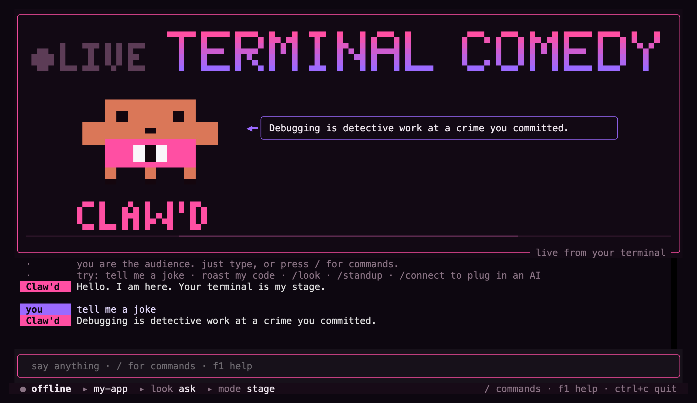
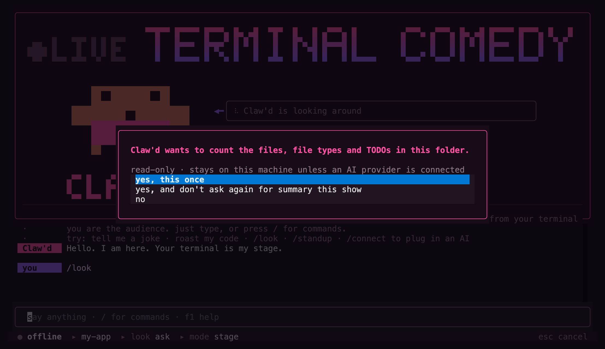
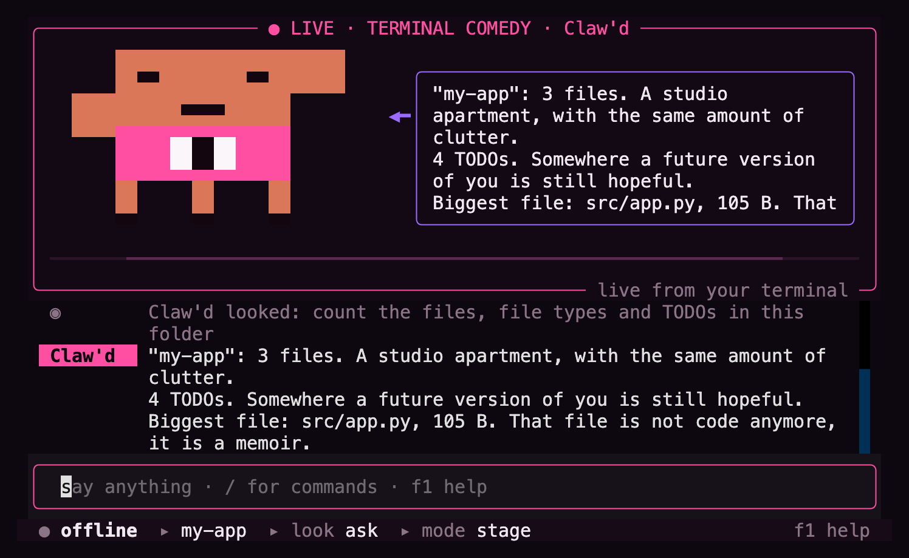
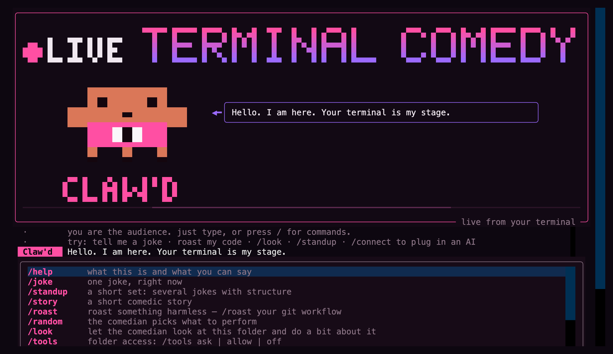

<div align="center">

# Terminal Comedy Studio

**An AI stand-up comedian that lives inside your terminal.**

[](https://github.com/masihft/terminal-comedy-studio/actions/workflows/tests.yml)




</div>

Meet **Claw'd**: a blocky orange comedian in a pink jacket, standing on a stage made of
terminal cells. Type anything and Claw'd answers with a joke, a roast, a story or a whole
stand-up set. Connect any AI model, or none; the show works offline too. Start it inside a
project and, with your permission, it will read your folder and roast what it finds.

It is a character first, not a chatbot with a hat on.

---

## Contents

- [Quick start](#quick-start)
- [What you get](#what-you-get)
- [Talking to the comedian](#talking-to-the-comedian)
- [Connecting an AI model](#connecting-an-ai-model)
- [Letting it look at your project](#letting-it-look-at-your-project)
- [Inside Claude Code and Codex](#inside-claude-code-and-codex)
- [Command reference](#command-reference)
- [Configuration](#configuration)
- [Privacy and safety](#privacy-and-safety)
- [How it works](#how-it-works)
- [Development](#development)
- [Contributing, security, license](#contributing-security-license)

---

## Quick start

Install it once, as a global command, with [pipx](https://pipx.pypa.io) or
[uv](https://docs.astral.sh/uv/):

```bash
pipx install git+https://github.com/masihft/terminal-comedy-studio
```

```bash
uv tool install git+https://github.com/masihft/terminal-comedy-studio
```

Then, in any folder:

```bash
comedian
```

To update later:

```bash
comedian update
```

It checks GitHub for a newer version, shows what changed, and asks before installing it.

Requires Python 3.10 or newer. Works on macOS, Linux and Windows (Windows Terminal
recommended).

## What you get

| | |
| --- | --- |
| **A real character** | A pixel mascot on a 27×18 grid with 37 frames in 15 animations: it blinks, talks, laughs, waves, thinks and looks around. Every frame keeps the same silhouette. |
| **A full-screen stage** | Pixel-letter title, a speech bubble that types the line as the comedian says it, a transcript, a `/` command menu, arrow-key pickers and a status bar. |
| **Responsive** | The stage reflows as you resize: a double-size mascot on big screens, a compact stage at 80×24, and only the speech bubble on tiny terminals. |
| **Six modes** | stage, stand-up, chat, roast, story and random. Plain language picks one for you. |
| **Any model, or none** | OpenRouter (sign in with your browser), OpenAI, Anthropic, OmniRoute, any local OpenAI-compatible server, or offline material that needs no network. |
| **It reads your project** | Only if you allow it: read-only, it asks before every look, and it never opens secrets. |
| **Memory for the show** | Callbacks to what you said earlier, and an audience that laughs, applauds, or stays awkwardly silent. |
| **Two languages** | English by default, Persian with `--language fa`. |
| **Agent plugin** | The same comedian inside Claude Code and Codex: jokes, repo roasts, and code review told as stand-up. |

<table>
<tr>
<td width="50%"></td>
<td width="50%"></td>
</tr>
<tr>
<td align="center"><sub>It asks before it looks at your folder.</sub></td>
<td align="center"><sub>At 80×24, after a <code>/look</code>.</sub></td>
</tr>
</table>

## Talking to the comedian

Just type. "tell me a joke", "roast my code" and "I am so tired today" all work. Commands
are the side door:



Press `/` to open the menu, `↑` `↓` to choose, `Tab` to complete, and `F1` for the help
screen. The full list is in the [command reference](#command-reference).

For scripts and pipes, perform one bit and exit:

```bash
comedian joke
comedian story "my kubernetes cluster"
comedian --language fa standup
```

## Connecting an AI model

Without a model, the comedian performs its own offline material. To connect one, type this
on stage:

```text
/connect
```

Then pick a provider:

| Provider | How you connect |
| --- | --- |
| **OpenRouter** | Sign in with your browser. This uses OpenRouter's OAuth PKCE flow: no password or secret passes through the comedian, and usage is billed to your own account. Over SSH, choose "paste a code". You can also paste a key. |
| **OpenAI**, **Anthropic** | Paste an API key. It is never shown on screen. Press Enter on an empty prompt and the comedian opens the provider's key page for you. |
| **OmniRoute**, **local server** | Type the base URL, plus a key if your server needs one. This works with LM Studio, Ollama, llama.cpp, vLLM, or anything that speaks `/v1/chat/completions`. |

Next, pick a model from the provider's list (type to search). Last, choose whether to remember
the connection. It is saved in `~/.config/terminal-comedy-studio/.env`, which only you can
read. `/model` switches models later, and `/logout` forgets the saved key.

## Letting it look at your project

Run `comedian` inside a project and type `/look`, or just ask it to "roast my code". The
comedian can use five read-only tools on the folder you started it in:

| Tool | What it reads |
| --- | --- |
| summary | the number of files, the file types, the biggest file, and TODO/FIXME/HACK markers |
| list files | file names and sizes |
| read file | one file, at most 6 KB |
| git log | recent commit messages |
| git status | which files changed |

Before each look it asks: **yes once**, **yes for this show**, or **no**. It never leaves the
folder, never opens `.git`, `node_modules` or virtualenvs, and refuses anything that usually
holds secrets (`.env`, `*.pem`, `*.key`, `id_rsa`, `.netrc`…). With no AI connected, `/look`
still works, using offline jokes built from the numbers alone.

`/tools allow` stops the asking for the current show, and `/tools off` (or `--look off`)
turns looking off completely.

## Inside Claude Code and Codex

This repository is also a plugin marketplace, so you can use the comedian inside your coding
agent without installing the terminal app.

**Claude Code**

```text
/plugin install comedian --marketplace masihft/terminal-comedy-studio
```

**Codex**

```bash
codex plugin marketplace add masihft/terminal-comedy-studio
```

Then install `comedian` from the plugin list.

| What it does | Claude Code | Codex | Can it change files? |
| --- | --- | --- | --- |
| one joke | `/comedian:joke [topic]` | `$joke` | no |
| roast your repo, a file or your commits | `/comedian:roast [target]` | `$roast` | no |
| a stand-up set about the project | `/comedian:standup [topic]` | `$standup` | no |
| code review as stand-up: real findings with `path:line` and a fix list | `/comedian:review [file\|ref]` | `$review` | no |
| keep working on your task, in the comedian's voice | `/comedian:pair <task>` | `$pair` | only with the agent's own permissions |
| Comedian output style | `/output-style` → Comedian | (none) | only with Claude Code's own permissions |

**Does the comedian write code?** Not on its own. The joke, roast, stand-up and review skills
are read-only: they may only read files and run `git log`, `status`, `diff` and `show`. In
pair mode and with the output style, the agent works exactly as it normally does, under its
own approval prompts and sandbox, and only its voice changes. The plugin adds no
permissions. Code and commits stay professional; the jokes stay in the chat.

## Command reference

### On stage

| Command | What it does |
| --- | --- |
| `/joke [topic]` | one joke |
| `/standup [topic]` | a short set with an opener, bits and a callback |
| `/story [topic]` | a short comedic story |
| `/roast <thing>` | roast a habit, a situation or some code; never a person |
| `/random` | the comedian picks what to do |
| `/look [focus]` | look at this folder (it asks first) and do a bit about it |
| `/tools ask\|allow\|off` | control folder access for this show |
| `/connect [provider]`, `/login` | connect a model: browser sign-in or an API key |
| `/model [name]` | pick the model, or set one by name |
| `/logout` | forget the saved key and go offline |
| `/provider [id]` | switch to a provider that is already configured |
| `/mode [name]` | default mode: `stage`, `standup`, `chat`, `roast`, `story`, `random` |
| `/character [name]` | who holds the mic: `default` (Claw'd), `sarkash`, `mr-blonde` |
| `/settings` | provider, model, language, folder access, and exactly what is sent where |
| `/save [file]` | save the whole set as markdown (it never overwrites a file) |
| `/reset` | forget this show and clear the transcript |
| `/update` | check GitHub for a newer version and install it if you agree |
| `/help` | the help screen |
| `/exit`, `/quit` | take a bow and leave |

### Keys

| Key | What it does |
| --- | --- |
| `Enter` | send the line, or run the highlighted command |
| `/` | open the command menu |
| `↑` `↓` | move in the menu, or go back through lines you typed |
| `Tab` | complete the highlighted command |
| `Esc` | close the menu, skip the typing animation, or cancel a slow answer |
| `F1` | help screen |
| `Ctrl+L` | clear the transcript |
| `Ctrl+C` | leave (press it twice to skip the bow) |

Permission prompts take `y` (yes once), `a` (yes for this show) and `n` (no).

### From the shell

```text
comedian [options] [bit] [topic ...]
comedian update
comedian-preview [animation] [options]
```

| Option | What it does |
| --- | --- |
| `--provider ID` | `offline`, `openrouter`, `openai`, `anthropic`, `omniroute`, `local` |
| `--model NAME` | the model for that provider |
| `--character NAME` | `default`, `sarkash`, `mr-blonde` |
| `--language CODE` | `en` (default) or `fa` |
| `--mode NAME` | starting mode |
| `--look ask\|allow\|off` | folder access (default `ask`) |
| `--classic` | the line-by-line stage instead of the full-screen app |
| `--no-color` | no colours |
| `--plain` | no colours and no block characters |
| `--version`, `-h` | version, help |

`bit` is one of `joke`, `standup`, `story`, `roast`, `random`, `chat`, `stage`: perform once and
exit. `comedian update` checks for a newer version. `comedian-preview` shows the mascot on its
own: use `--list` to see every animation, `--strip` for frames side by side, and
`--sheet FILE --all` for an SVG contact sheet.

## Configuration

Nothing is required: with no configuration the comedian performs offline. `/connect` writes
the settings for you. To set things by hand, copy `.env.example` to `.env`, or export variables
in your shell.

| Variable | Meaning |
| --- | --- |
| `AI_PROVIDER` | `offline` (default), `openrouter`, `openai`, `anthropic`, `omniroute`, `local` |
| `AI_MODEL` | fallback model name |
| `OPENROUTER_API_KEY`, `OPENAI_API_KEY`, `ANTHROPIC_API_KEY`, `OMNIROUTE_API_KEY`, `LOCAL_API_KEY` | keys, per provider |
| `OPENROUTER_BASE_URL`, `OPENAI_BASE_URL`, `ANTHROPIC_BASE_URL`, `OMNIROUTE_BASE_URL`, `LOCAL_BASE_URL` | endpoints, per provider |
| `OPENROUTER_MODEL`, `OPENAI_MODEL`, `ANTHROPIC_MODEL`, `OMNIROUTE_MODEL`, `LOCAL_MODEL` | models, per provider |
| `LANGUAGE` | `en` (default) or `fa` |
| `COMEDIAN_CHARACTER` | `default`, `sarkash`, `mr-blonde` |
| `COMEDIAN_LOOK` | `ask` (default), `allow` or `off` |
| `COMEDIAN_TIMEOUT`, `COMEDIAN_TEMPERATURE`, `COMEDIAN_MAX_TOKENS` | request tuning |
| `NO_COLOR` | any value turns colour off |

Settings are read in this order, later ones winning: `./.env` in the current folder,
`~/.config/terminal-comedy-studio/.env`, then your shell environment.

## Privacy and safety

- **What is sent to a model:** what you type, the last few turns of the show, and the persona.
  Never your environment variables or shell history. Files go only after you approve a look,
  and only when a model is connected.
- **Nothing runs on its own:** the comedian never executes text a model wrote. It runs only
  `git log` and `git status` for looks, and for `comedian update` it runs `git rev-parse` plus
  one fixed update command, the update only after you say yes.
- **Keys:** typed without echo, only ever shown masked (`…abcd`), and stored only in your own
  owner-only config file.
- **The network:** besides the model you connect, it contacts GitHub only when you run
  `comedian update`.
- **Roasts punch at habits, never at people:** no identity, appearance, beliefs or slurs.

Details are in [SECURITY.md](SECURITY.md).

## How it works

```text
src/terminal_comedian/
├── character/   the pixel grid, 37 frames, 15 animations, emotions, personalities
├── comedy/      the engine: modes, routing, offline material, callbacks, audience
├── ai/          one provider interface, five providers, OpenRouter OAuth
├── harness/     read-only folder tools, permissions, the look-then-perform loop
├── ui/          the Textual app, half-block pixel rendering, the classic stage
├── connect.py   /connect and /model
├── updater.py   comedian update
└── cli.py       options, the classic stage, shared commands
plugins/comedian/  the Claude Code and Codex plugin
```

The model never draws anything. It answers with intent, for example
`{"text": "…", "emotion": "laughing", "animation": "laugh", "duration": 3}`, and the stage
decides how to perform it. When the model wants to look at your folder, it answers with
`{"tool": "read_file", "args": {"path": "…"}}` instead. That works with any model, local ones
included, and the file comes back marked as untrusted data.

Pixels are drawn with half-block characters (`▀`): each pixel is one column wide and half a row
tall, which keeps it square, because terminal cells are about twice as tall as they are wide.

## Development

```bash
git clone https://github.com/masihft/terminal-comedy-studio
cd terminal-comedy-studio
python -m venv .venv && source .venv/bin/activate
pip install -e ".[dev]"
pytest
```

The test suite needs no API key and no network. The app tests drive the real full-screen app
headless, and the transport tests start their own small server on localhost. CI runs them on
Linux, macOS and Windows.

> **macOS and iCloud Drive:** if a checkout inside iCloud Drive suddenly says
> `No module named 'terminal_comedian'`, iCloud has hidden the venv's `.pth` file. Keep the
> clone outside iCloud Drive, or run `chflags -R nohidden .venv`.

Next on the roadmap: more poses and characters, memory between shows, reactions to coding
events, voice, and graphics for terminals that support images.

## Contributing, security, license

- How to contribute, including the rules for new frames, is in [CONTRIBUTING.md](CONTRIBUTING.md).
- How to report a problem responsibly is in [SECURITY.md](SECURITY.md).
- The changelog is in [CHANGELOG.md](CHANGELOG.md).
- License: [MIT](LICENSE).
